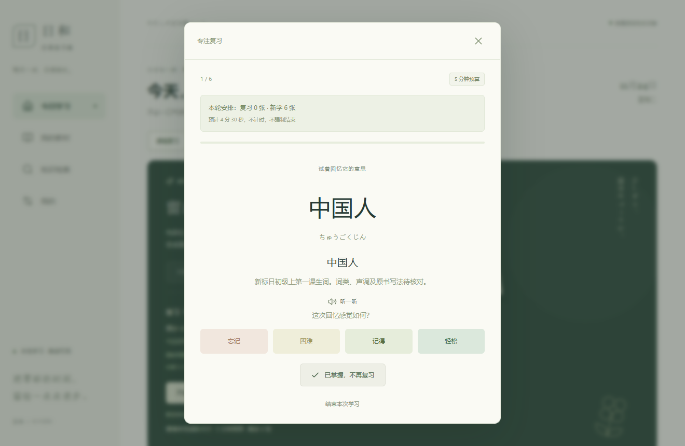
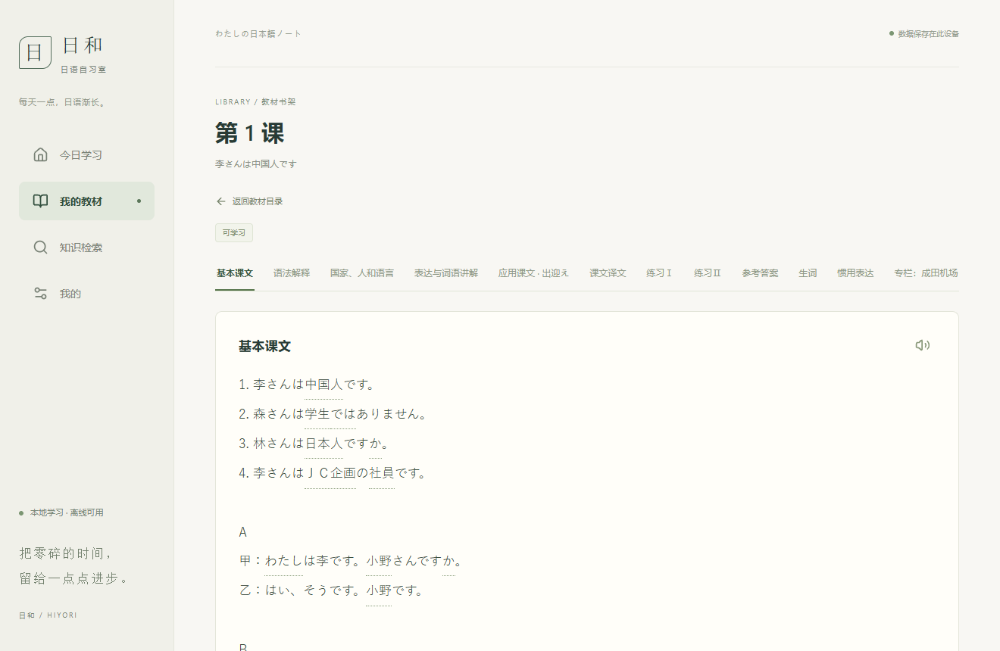
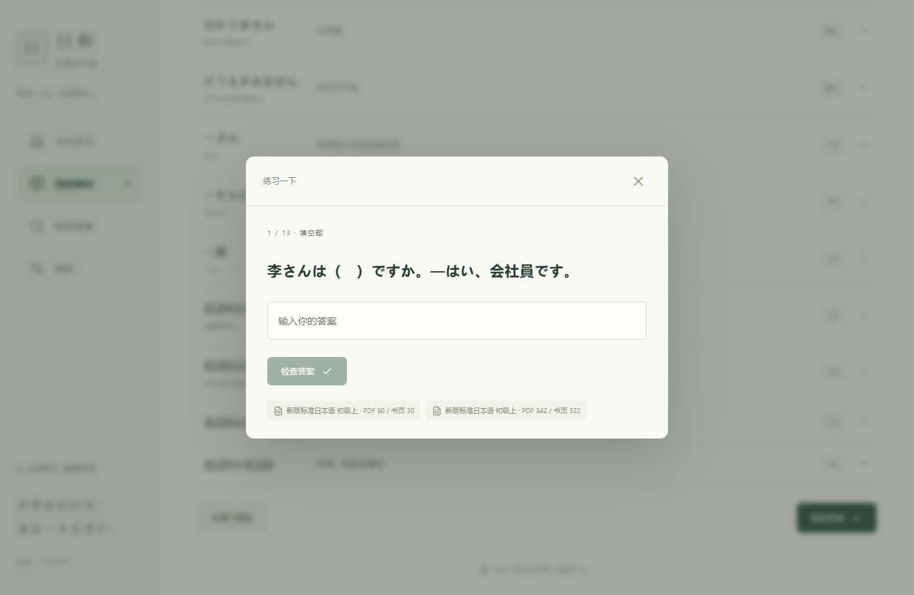
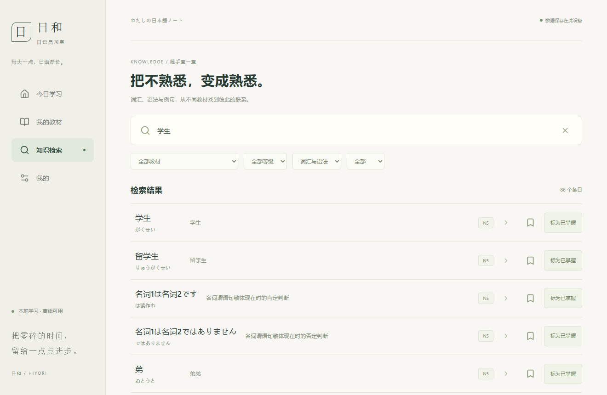
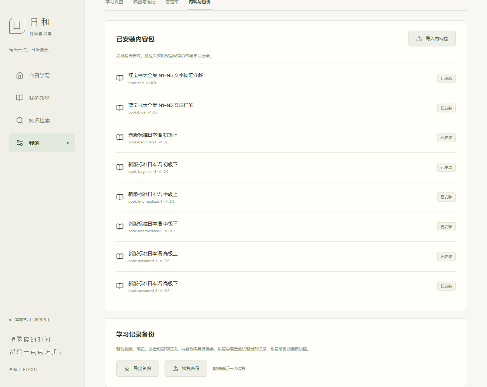

# 日和日语自习室

日和是一个支持 Windows 浏览器和 Android 的日语自习工具。内置《新版标准日本语》初级、中级、高级上下册及红宝书、蓝宝书的已发布学习包。教材阅读、检索、复习和测验均可离线使用，学习记录保存在当前浏览器或应用的本地存储中。

[功能介绍](#功能介绍) · [网页版](#网页版) · [安卓版](#安卓版) · [源码结构](#源码结构)

## 功能介绍

### 今日学习与卡片复习

从 3、5 或 10 分钟的学习单元开始，按课程复习或按 JLPT 目标等级查漏。系统根据时间预算、到期卡片和每日新卡上限安排队列，显示预计所需时间。中途退出后可以继续未完成的复习或测验。


卡片先让你回忆，再显示读音与释义。选择「忘记」「困难」「记得」「轻松」四档反馈，FSRS 会据此安排下次复习。已经掌握的条目可以从复习队列移出。



### 教材阅读与课后测验

在「我的教材」按册和课次打开已整理的课文、语法、词汇和练习。阅读时可直接点开已关联的词条，查看讲解、例句和页码出处。应用保存每课的阅读位置，可设置起始课次，也可以手动标记学完。



已核对的选择题和填空题可用于课后小测验。提交后能查看结果和解释，答错的题会进入错题本，供单独重练。测验记录与卡片的 FSRS 状态分别保存。



### 知识检索

可输入日文汉字、假名或中文释义，按教材、JLPT 等级、条目类型和学习状态筛选。结果包括知识条目以及已整理正文的匹配段落，点击正文结果可跳到对应栏目。已核对的跨教材关联会在同一个词条中展示，收藏、笔记和掌握状态在各入口共享。



### 学习记录、内容包与备份

「我的」集中管理收藏、笔记、错题、新卡上限和目标等级。内容包经过校验后安装，学习记录可导出为 ZIP，恢复前会保存当前记录的快照。备份会记录所需内容包，换设备时可按提示补装。



网页版的词句点读使用设备上的日语离线语音。当前 Android 工程尚未接入原生点读组件，离线阅读、检索和练习仍可用。

## 网页版

安装 **Node.js 22.12 或更新版本**。克隆仓库或下载并解压源码后，在项目根目录执行以下命令。首次安装依赖通常需要联网。

```powershell
npm.cmd ci
npm.cmd run build
```

构建脚本先执行 TypeScript 类型检查，再用 Vite 生成 `dist/`，同时将已发布的学习包复制到 `dist/packs/`。修改源码后，重新执行构建命令即可更新运行文件。

构建成功后，在 Windows 上双击 [`start-hiyori.bat`](./start-hiyori.bat)，或在项目根目录运行下列命令并用浏览器打开 <http://127.0.0.1:4173>。

```powershell
npm.cmd start
```

本地服务仅监听 `127.0.0.1:4173`。如果端口已被占用，关闭占用该端口的程序后重试。按 `Ctrl+C` 停止服务。

### 开发模式

安装依赖后，运行以下命令，并打开终端显示的本地地址。修改源码后，Vite 会自动更新页面。

```powershell
npm.cmd run dev
```

## 安卓版

### 安装与运行

有已签名的 APK 时，可把它传到 **Android 7.0（API 24）或以上**、且系统 WebView 已更新的设备上安装，然后打开「日和」。首次打开会从应用自带的内容包初始化教材，之后可离线学习。

### 从源码构建调试 APK

在 Windows 上准备 **Node.js 22.12+、JDK 21、Android SDK Platform 36、Android SDK Build-Tools 36.0.0**。需要连接真机时，在 Android Studio 的 SDK Manager 里同时安装 Android SDK Platform-Tools。设置 `JAVA_HOME` 指向 JDK，`ANDROID_HOME` 指向本机 Android SDK。Gradle Wrapper 会使用项目固定的 Gradle 版本，首次构建需要联网下载依赖。

在项目根目录执行以下命令。脚本会构建网页、同步 Capacitor，再生成已用调试密钥签名的 APK。

```powershell
npm.cmd ci
powershell.exe -NoProfile -ExecutionPolicy Bypass -File .\scripts\build-android.ps1
```

产物位于 `android/app/build/outputs/apk/debug/app-debug.apk`。可在 Android Studio 中打开 `android/` 并选择模拟器运行，也可以在开启 USB 调试并完成授权的测试设备上安装。

```powershell
& "$env:ANDROID_HOME\platform-tools\adb.exe" install -r .\android\app\build\outputs\apk\debug\app-debug.apk
```

### 构建并签名发布 APK

发布版本号和内部版本号分别由 `android/app/build.gradle` 的 `versionName` 和 `versionCode` 控制。发布更新时递增 `versionCode`，并继续使用此前发布的应用签名密钥。[Android 应用签名](https://developer.android.com/studio/publish/app-signing)

```powershell
powershell.exe -NoProfile -ExecutionPolicy Bypass -File .\scripts\build-android.ps1 -Release
```

产物位于 `android/app/build/outputs/apk/release/app-release-unsigned.apk`。可以在 Android Studio 中使用 **Build → Generate Signed App Bundle or APK**，选择 **APK** 和 **release**。也可以在 PowerShell 中使用下面的命令，将密钥库路径和别名替换为自己的值。签名工具会提示输入密码。

```powershell
$apksigner = "$env:ANDROID_HOME\build-tools\36.0.0\apksigner.bat"
& $apksigner sign --ks 'C:\安全目录\hiyori-release.p12' --ks-key-alias hiyori `
  --out .\hiyori-release.apk .\android\app\build\outputs\apk\release\app-release-unsigned.apk
& $apksigner verify --verbose .\hiyori-release.apk
```

签名后可在测试设备上验证安装和升级。将密钥库和密码保存在本地安全位置。

## 源码结构

| 路径 | 作用 |
| --- | --- |
| [`app/index.html`](./app/index.html)、[`app/src/main.tsx`](./app/src/main.tsx) | 网页入口，挂载 React 应用。 |
| [`app/src/App.tsx`](./app/src/App.tsx)、[`app/src/style.css`](./app/src/style.css) | 学习首页、教材、检索和个人记录界面，以及全局样式。 |
| [`app/src/store.ts`](./app/src/store.ts)、[`app/src/types.ts`](./app/src/types.ts) | 定义教材和学习记录的数据类型，通过 Dexie 访问 IndexedDB，并处理内容包导入、复习记录和备份。 |
| [`app/src/search-index.ts`](./app/src/search-index.ts)、[`app/src/content-links.ts`](./app/src/content-links.ts)、[`app/src/reference-levels.ts`](./app/src/reference-levels.ts) | 构建检索索引、关联课文中的词条，并按教材和 JLPT 等级筛选。 |
| [`app/src/study-plan.ts`](./app/src/study-plan.ts)、[`app/src/platform.ts`](./app/src/platform.ts) | 选择学习单元中的到期卡和新卡，封装日语点读和文件下载。 |
| [`app/public/packs/`](./app/public/packs)、[`content/book-packs.json`](./content/book-packs.json) | 存放运行时读取的学习包目录和 8 个已发布 ZIP，以及应用引用的课次和等级成员合并顺序。 |
| [`scripts/build.mjs`](./scripts/build.mjs)、[`scripts/serve.mjs`](./scripts/serve.mjs)、[`start-hiyori.bat`](./start-hiyori.bat) | 执行网页构建、提供 `dist/` 本地服务，以及在 Windows 上双击启动。 |
| [`capacitor.config.ts`](./capacitor.config.ts)、[`android/`](./android)、[`scripts/build-android.ps1`](./scripts/build-android.ps1) | 定义应用标识和网页入口，保存 Android 原生工程及 Gradle Wrapper，构建和同步 APK 所需文件。 |
| [`package.json`](./package.json)、[`package-lock.json`](./package-lock.json)、[`tsconfig.json`](./tsconfig.json)、[`vite.config.ts`](./vite.config.ts) | 定义依赖、npm 命令、TypeScript 检查和 Vite 构建配置。 |
